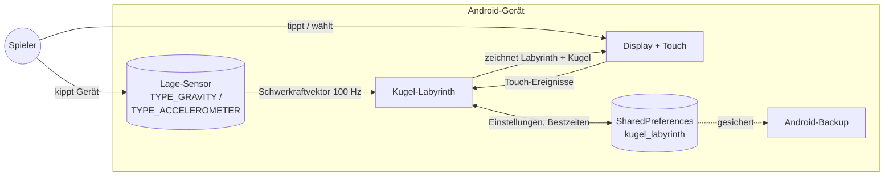
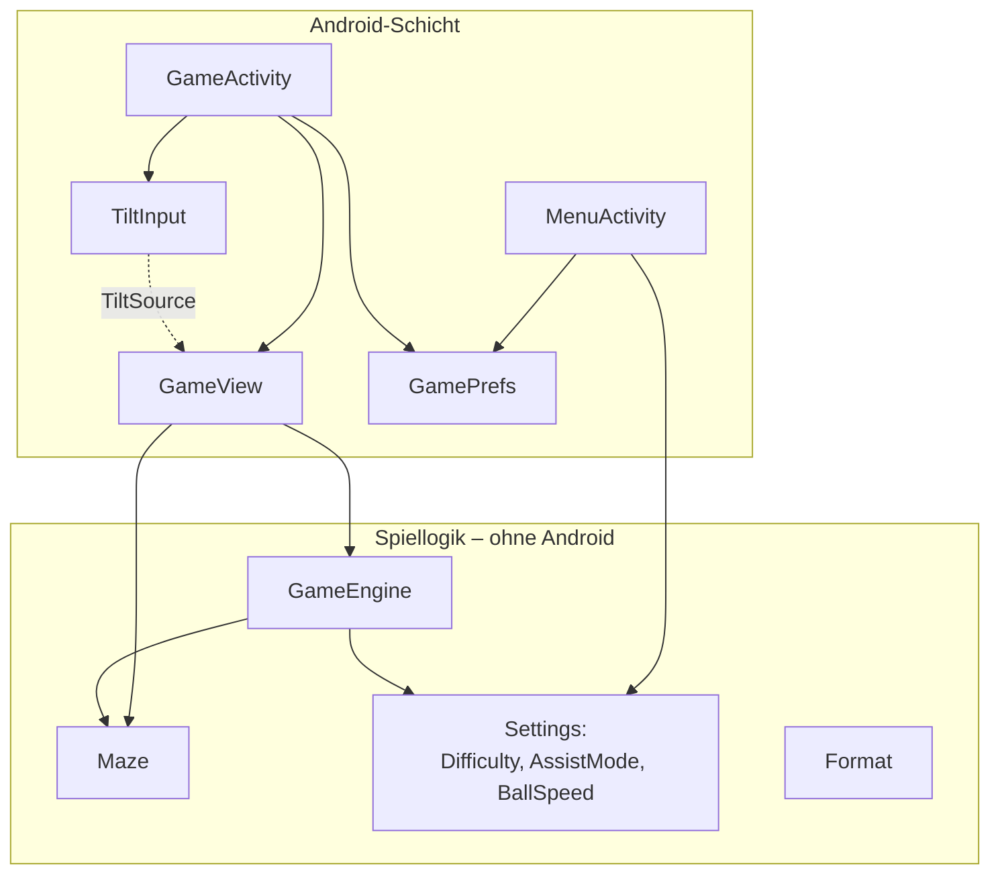
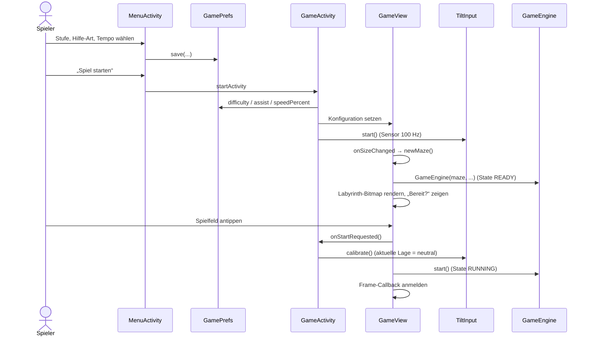
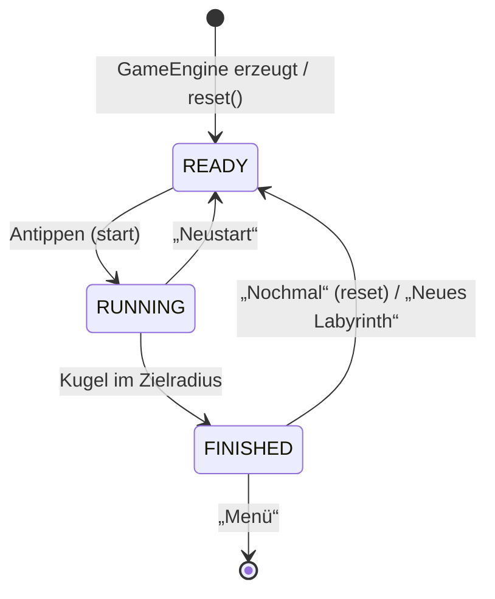
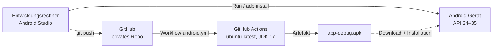

# 2 Architekturdokumentation

Gliederung angelehnt an [arc42](https://arc42.org). Stand: App-Version 1.3.0.

## 1 Einführung und Ziele

### 1.1 Aufgabenstellung

Android-App, in der eine Kugel durch Neigen des Handys durch ein zufällig erzeugtes Labyrinth gesteuert wird. Vier Schwierigkeitsstufen unterscheiden sich in der Stärke der Unterstützung. Es gibt zwei Hilfe-Arten (Empfindlichkeit, Software-Hilfe) und eine einstellbare Kugelgeschwindigkeit. Details: [Anforderungen](01-anforderungen.md).

### 1.2 Qualitätsziele

| Priorität | Qualitätsziel | Bedeutung für dieses Projekt |
|---|---|---|
| 1 | **Spielgefühl / Flüssigkeit** | Die Kugel reagiert sofort und läuft bei 60–120 Hz ruckelfrei (NFA-01, NFA-02). |
| 2 | **Korrektheit / Robustheit** | Die Kugel durchdringt nie eine Wand, auch nicht bei Rucklern oder 200 % Tempo (FA-03, NFA-06). Die Hilfen tun genau das, was sie versprechen (FA-06 … FA-08, FA-15). |
| 3 | **Wartbarkeit / Testbarkeit** | Die Spiellogik ist ohne Gerät testbar, und alle Stellgrößen liegen an einer Stelle (NFA-08, NFA-09). |

### 1.3 Stakeholder

| Rolle | Person | Erwartung |
|---|---|---|
| Auftraggeber, Product Owner, Entwickler | David (Neon153) | Funktionsfähige App, nachvollziehbarer Code, vollständige Dokumentation |
| Spieler | Endnutzer | Intuitive Steuerung, faire Schwierigkeit, flüssige Bewegung |

## 2 Randbedingungen

| Typ | Randbedingung |
|---|---|
| Technisch | Android 7.0 – 15 (API 24 – 35); Kotlin 2.0.21; Android Gradle Plugin 8.7.3; Gradle 8.9; JDK 17 |
| Technisch | Entwicklung mit Android Studio; Build über Gradle-Wrapper |
| Technisch | Keine Bibliotheken außer Android-Framework und Kotlin-Standardbibliothek (Test: JUnit 4.13.2) |
| Organisatorisch | Ein-Personen-Projekt; privates GitHub-Repository; CI mit GitHub Actions |
| Konvention | Code, Kommentare und Oberfläche auf Deutsch; Bezeichner auf Englisch |

## 3 Kontextabgrenzung

| Schnittstelle | Richtung | Inhalt |
|---|---|---|
| Lage-Sensor | Eingang | Beschleunigungsvektor in m/s² (Gerätekoordinaten), ca. 100 Hz |
| Touch | Eingang | Antippen des Spielfelds (Start), Menüauswahl, Schaltflächen |
| Display | Ausgang | Labyrinth, Kugel, Zeit, Dialoge |
| SharedPreferences | Ein/Ausgang | Stufe, Hilfe-Art, Tempo, Bestzeiten |

Die App nutzt kein Netzwerk und benötigt keine Berechtigungen.

## 4 Lösungsstrategie

| Ziel | Ansatz |
|---|---|
| Flüssigkeit | Spielschleife über `Choreographer` (vsync), fester Physik-Zeitschritt mit Interpolation ([ADR-003](06-entscheidungen.md#adr-003-fester-physik-zeitschritt-mit-interpolation)), statisches Labyrinth als vorgerenderte Bitmap, keine Allokationen pro Frame |
| Robustheit | 480-Hz-Physik, Geschwindigkeitsgrenze pro Schritt, Zeitsprünge begrenzt, Kollision gegen vollständigen Zellenindex ([ADR-009](06-entscheidungen.md#adr-009-zusammengefasste-wände-und-zellenindex)) |
| Testbarkeit | Spiellogik in reinem Kotlin ohne Android-Abhängigkeiten ([ADR-002](06-entscheidungen.md#adr-002-spiellogik-ohne-android-abhängigkeiten)) |
| Einfachheit | Native Views + Canvas, keine Game-Engine, keine Bibliotheken ([ADR-001](06-entscheidungen.md#adr-001-native-android-views-und-canvas-ohne-bibliotheken)) |

## 5 Bausteinsicht

### 5.1 Ebene 1

`Format` (Zeitformat) wird von beiden Activities genutzt und ist zur Übersicht nicht eingezeichnet.

### 5.2 Bausteine

Alle Dateien liegen in `app/src/main/java/com/example/kugellabyrinth/`.

| Baustein | Datei | Verantwortung | Android-frei |
|---|---|---|---|
| `Difficulty`, `AssistMode`, `BallSpeed` | `Settings.kt` | Stufen (Spalten, Hilfestärke), Hilfe-Arten, Tempo-Bereich 50–200 % | ✔ |
| `Maze` | `Maze.kt` | Labyrinth erzeugen (Recursive Backtracker), Ziel bestimmen (BFS), Wände zu Rechtecken zusammenfassen, Wand-Index pro Zelle | ✔ |
| `GameEngine` | `GameEngine.kt` | Zustandsautomat, Physik (480 Hz), Kollision, Hilfe-Logik, Zeit, Interpolation | ✔ |
| `tenthsOf`, `formatSeconds` | `Format.kt` | Zeitformat „12,3 s“ ohne Allokation von Formatierern | ✔ |
| `GameView` | `GameView.kt` | Zeichnen, Spielschleife (`Choreographer`), Touch-Start, Labyrinth-Bitmap | – |
| `TiltInput` | `TiltInput.kt` | Sensor an- und abmelden, Achsen nach Display-Rotation, Tiefpass, Kalibrierung | – |
| `GameActivity` | `GameActivity.kt` | Spielbildschirm, Lebenszyklus, Zeitanzeige, Ergebnisdialog | – |
| `MenuActivity` | `MenuActivity.kt` | Menü (Stufe, Hilfe-Art, Tempo), Erklärungstext, Bestzeit | – |
| `GamePrefs` | `GamePrefs.kt` | Einstellungen und Bestzeiten speichern; Anzeigetexte der Enums | – |

### 5.3 Schnittstellen zwischen den Bausteinen

| Schnittstelle | Anbieter → Nutzer | Zweck |
|---|---|---|
| `GameView.TiltSource` (`tiltX`, `tiltY`) | `TiltInput` → `GameView` | Kalibrierte Neigung in m/s² auf Bildschirmachsen |
| `GameView.Listener` | `GameView` → `GameActivity` | `onTimeChanged`, `onStartRequested` (→ Kalibrierung), `onFinished` |
| `GameEngine.update(dt, tiltX, tiltY): Boolean` | `GameEngine` → `GameView` | Simulation um `dt` fortschreiben; `true` genau einmal beim Ziel |
| `GameEngine.renderX/renderY` | `GameEngine` → `GameView` | Interpolierte Position zum Zeichnen |

## 6 Laufzeitsicht

### 6.1 Spielstart

### 6.2 Ein Frame

Sensor-Ereignisse kommen unabhängig davon in `TiltInput.onSensorChanged` an. Dort werden die Werte gefiltert und `tiltX`/`tiltY` aktualisiert. Beides läuft auf dem Main-Thread, deshalb ist keine Synchronisation nötig.

### 6.3 Zustandsautomat der Engine

Bei `onPause` bleibt der Zustand erhalten, nur die Frame-Callbacks werden abgemeldet. Die Zeit läuft dann nicht weiter. Bei `onResume` geht es ohne Zeitsprung weiter, weil der erste Frame nur den Zeitstempel setzt.

## 7 Verteilungssicht

Die App ist eine einzelne APK ohne Server-Komponente. Die CI führt bei jedem Push Unit-Tests und Lint aus und baut die Debug-APK (siehe [Entwicklerhandbuch](05-entwicklerhandbuch.md#55-continuous-integration)).

## 8 Querschnittliche Konzepte

### 8.1 Koordinaten und Einheiten

| Größe | Einheit | Bemerkung |
|---|---|---|
| Position, Wände | Zelle | Zelle (c, r) belegt [c, c+1] × [r, r+1]; Ursprung oben links, y nach unten |
| Geschwindigkeit | Zellen/s | |
| Beschleunigung | Zellen/s² | |
| Neigung (Eingang) | m/s² | Schwerkraftkomponente in der Bildschirmebene; ≈ 9,81 · sin θ |
| Zeit | s | Physik-Schritt 1/480 s |
| Pixel | px | nur in `GameView`: Pixel = Offset + Zelle · Zellgröße |

### 8.2 Nebenläufigkeit

Die gesamte App läuft auf dem Main-Thread: Sensor-Callbacks (ohne eigenen Handler registriert), `Choreographer`-Callbacks, Touch und Zeichnen. Es gibt keine Hintergrund-Threads und daher keine Synchronisation. `SharedPreferences.apply()` schreibt asynchron, das übernimmt das Framework.

### 8.3 Performance

- Physik und Kollision ohne Allokationen (primitive Felder, `FloatArray`/`IntArray`)
- Kollision nur gegen die durchschnittlich 3,7–3,8 Wände der aktuellen Zelle statt gegen alle (bis 435 Einzelwände bei „Profi“)
- Labyrinth einmal pro Spiel in eine Bitmap gerendert; pro Frame werden 1 Bitmap + 3 Kreise gezeichnet
- Zeitanzeige nur bei Wechsel der Zehntelsekunde aktualisiert; `TextView` mit fester Breite (kein Relayout)
- Gemessen: 0,86 µs Physik pro 60-Hz-Frame (8 Schritte) auf der JVM

### 8.4 Persistenz

Datei `kugel_labyrinth` (private SharedPreferences):

| Schlüssel | Typ | Inhalt |
|---|---|---|
| `difficulty` | String | `EASY`, `MEDIUM`, `HARD`, `PRO` |
| `assist` | String | `SENSITIVITY`, `SOFTWARE` |
| `speed_percent` | Int | 50 … 200 |
| `best_<STUFE>_<HILFE>_<TEMPO>` | Float | Bestzeit in s; `<HILFE>` = `NONE` bei Stufe `PRO` |

Unbekannte oder veraltete Werte (z. B. `assist = NONE` aus Version 1.2) fallen auf Standardwerte zurück (`fromName(..., fallback)`). SharedPreferences sind im Android-Cloud-Backup und bei der Geräteübertragung enthalten (`res/xml/backup_rules.xml`, `data_extraction_rules.xml`).

### 8.5 Fehlerbehandlung

| Situation | Verhalten |
|---|---|
| Kein Lage-Sensor | Hinweis-Toast; Spielfeld bleibt bedienbar, die Kugel bewegt sich nicht. Das Manifest verlangt den Sensor, deshalb wird die App im Play Store solchen Geräten nicht angeboten. |
| Kalibrierung ohne Sensorwert oder mit Display nach unten | Kalibrierung wird auf „keine Drehung“ zurückgesetzt |
| Großer Zeitsprung (Ruckler, Debugger) | Pro Frame höchstens 50 ms simuliert |
| Ergebnis nach Schließen der Activity | wird ignoriert (`isFinishing`/`isDestroyed`); offener Dialog wird in `onDestroy` geschlossen |

### 8.6 Lokalisierung und Barrierefreiheit

Alle Texte stehen in `res/values/strings.xml`. Texte mit wörtlichem `%` ohne Platzhalter sind als `formatted="false"` markiert. Auswahlfelder sind mindestens 48 dp hoch. Das Spielfeld ist klickbar und fokussierbar, hat eine Inhaltsbeschreibung und startet über `performClick`, also auch mit TalkBack.

## 9 Architekturentscheidungen

Siehe [Architekturentscheidungen (ADR)](06-entscheidungen.md).

## 10 Qualitätsanforderungen

Die messbaren Qualitätsanforderungen stehen als NFA-01 … NFA-13 in den [Anforderungen](01-anforderungen.md#14-nicht-funktionale-anforderungen), ihre Nachweise in den [Tests](07-tests.md).

## 11 Risiken und technische Schulden

| # | Risiko / Schuld | Auswirkung | Maßnahme / Status |
|---|---|---|---|
| R-1 | **Noch nicht auf einem echten Gerät getestet.** Build, Lint und Unit-Tests laufen in der CI mit echtem Android SDK; Sensor und Spielgefühl sind nur auf einem Gerät prüfbar. | Abweichungen im Spielgefühl oder gerätespezifische Fehler möglich | Manuelle Gerätetests MT-01 … MT-14 ([Tests 7.4](07-tests.md#74-manuelle-gerätetests)) |
| R-2 | Spielstand geht verloren, wenn Android die Activity neu erstellt (Sprach-/Schriftgrößenwechsel, Split-Screen, Prozess-Ende im Hintergrund) | Laufendes Spiel startet mit neuem Labyrinth | Bewusst nicht umgesetzt (kurze Spielrunden); bei Bedarf `onSaveInstanceState` mit Seed + Kugelzustand |
| R-3 | Nach Rückkehr aus dem Hintergrund läuft das Spiel sofort weiter, ohne erneute „Bereit?“-Anzeige | Kugel kann losrollen, bevor der Spieler bereit ist | Bei Bedarf Pause-Zustand ergänzen |
| R-4 | Physikmodell vereinfacht (geschwindigkeitsproportionale Reibung, Tempolimit, Totzone auf Eingabe, kein Drall) | Weniger realistisch als ein echtes Brett | Dokumentiert in [Fachkonzept 3.4](03-fachkonzept.md#34-physikalische-einordnung) |
| R-5 | Sensoren unterscheiden sich je nach Gerät (Rauschen, Abtastrate, kein `TYPE_GRAVITY`) | Unterschiedliches Spielgefühl | Zeitbasierter Tiefpass, Rückfall auf `TYPE_ACCELEROMETER` |
| R-6 | Release-Signatur nicht eingerichtet | Kein Play-Store-Release ohne weitere Schritte | Anleitung im [Entwicklerhandbuch](05-entwicklerhandbuch.md#57-release-build) |
| R-7 | Paketname `com.example.kugellabyrinth` | Im Play Store nicht zulässig | Vor einer Veröffentlichung umbenennen |

## 12 Glossar

Siehe [Glossar](08-glossar.md).
