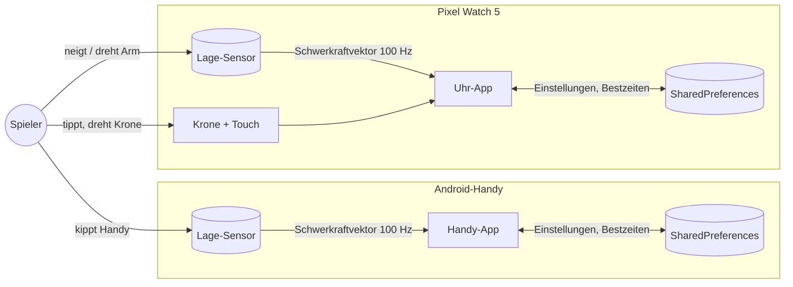
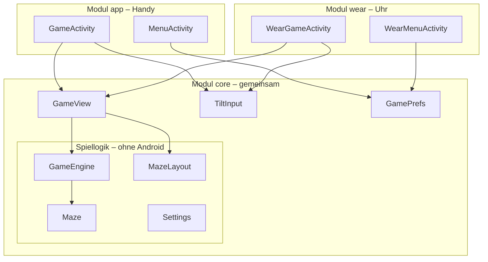
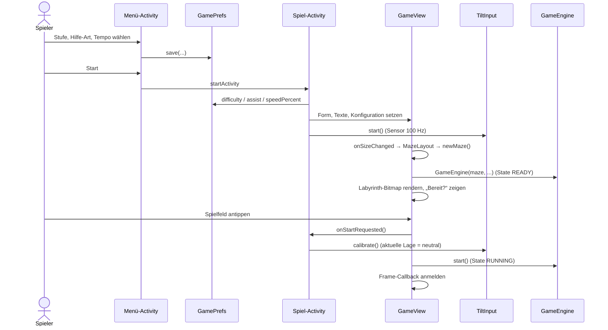
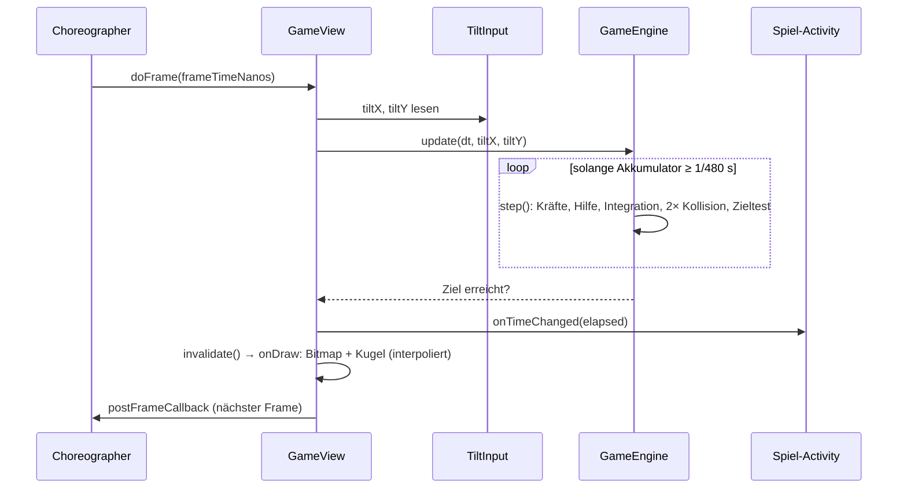
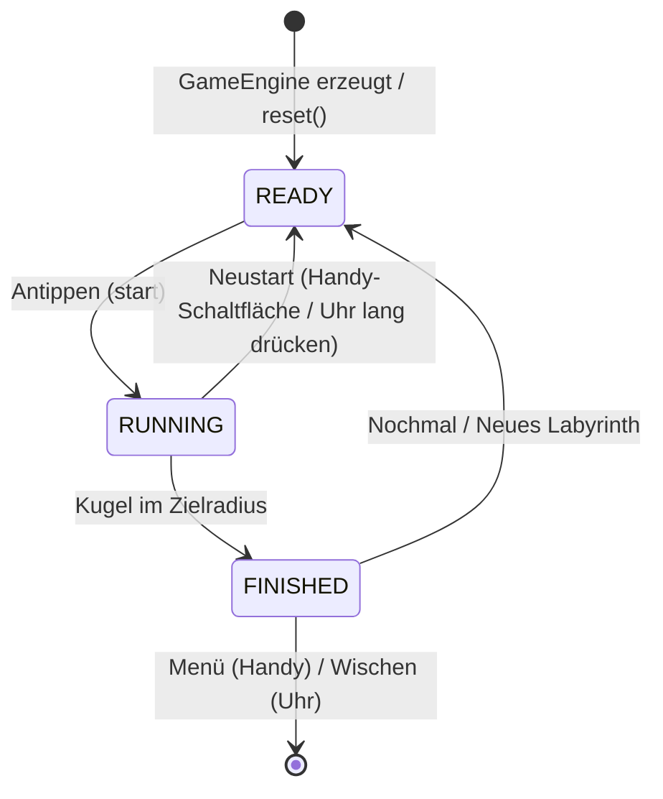
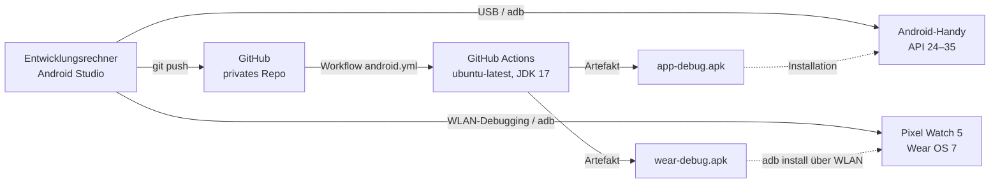

# 2 Architekturdokumentation

Gliederung angelehnt an [arc42](https://arc42.org). Stand: Version 1.4.0 (Handy-App und Uhr-App).

## 1 Einführung und Ziele

### 1.1 Aufgabenstellung

Ein Kugellabyrinth-Spiel in zwei Ausprägungen:
- **Handy-App:** Die Kugel wird durch Neigen des Handys gesteuert.
- **Uhr-App** für die Google Pixel Watch 5: Die Kugel wird durch Neigen und Drehen des Arms gesteuert.

Vier Schwierigkeitsstufen unterscheiden sich in der Stärke der Unterstützung. Es gibt zwei Hilfe-Arten (Empfindlichkeit, Software-Hilfe) und eine einstellbare Kugelgeschwindigkeit. Details: [Anforderungen](01-anforderungen.md).

### 1.2 Qualitätsziele

| Priorität | Qualitätsziel | Bedeutung für dieses Projekt |
|---|---|---|
| 1 | **Spielgefühl / Flüssigkeit** | Die Kugel reagiert sofort und läuft ruckelfrei, auf dem Handy bei 60–120 Hz, auf der Uhr bei 60 Hz (NFA-01, NFA-02). |
| 2 | **Korrektheit / Robustheit** | Die Kugel durchdringt nie eine Wand, auch nicht bei Rucklern oder 200 % Tempo (FA-03, NFA-06). Die Hilfen tun genau das, was sie versprechen (FA-06 … FA-08, FA-15). |
| 3 | **Wartbarkeit / Testbarkeit** | Spiellogik ohne Gerät testbar; Logik, Sensor und Spielfeld nur einmal für beide Geräte (NFA-09, NFA-16). |

### 1.3 Stakeholder

| Rolle | Person | Erwartung |
|---|---|---|
| Auftraggeber, Product Owner, Entwickler | David (Neon153) | Funktionsfähige Apps, nachvollziehbarer Code, vollständige Dokumentation |
| Spieler | Endnutzer mit Android-Handy und/oder Pixel Watch | Intuitive Steuerung, faire Schwierigkeit, flüssige Bewegung |

## 2 Randbedingungen

| Typ | Randbedingung |
|---|---|
| Technisch | Handy: Android 7.0 – 15 (API 24 – 35). Uhr: Wear OS 3+ (API 30 – 35), Zielgerät Pixel Watch 5 mit Wear OS 7, rundes Display 408 × 408 px (41 mm) bzw. 456 × 456 px (45 mm), 320 ppi, 1–60 Hz |
| Technisch | Kotlin 2.0.21; Android Gradle Plugin 8.7.3; Gradle 8.9; JDK 17 |
| Technisch | Keine Bibliotheken außer Android-Framework und Kotlin-Standardbibliothek, auch nicht auf der Uhr (Test: JUnit 4.13.2) |
| Organisatorisch | Ein-Personen-Projekt; privates GitHub-Repository; CI mit GitHub Actions |
| Konvention | Code, Kommentare und Oberfläche auf Deutsch; Bezeichner auf Englisch |

## 3 Kontextabgrenzung

| Schnittstelle | Richtung | Inhalt |
|---|---|---|
| Lage-Sensor | Eingang | Beschleunigungsvektor in m/s² (Gerätekoordinaten), ca. 100 Hz |
| Touch / Krone | Eingang | Antippen, langes Drücken, Wischen; Krone scrollt das Uhr-Menü |
| Display | Ausgang | Labyrinth, Kugel, Zeit, Ergebnis |
| SharedPreferences | Ein/Ausgang | Stufe, Hilfe-Art, Tempo, Bestzeiten, je Gerät lokal |

Handy und Uhr arbeiten unabhängig voneinander. Es gibt keine Datenverbindung zwischen ihnen, kein Netzwerk und keine Berechtigungen.

## 4 Lösungsstrategie

| Ziel | Ansatz |
|---|---|
| Flüssigkeit | Spielschleife über `Choreographer` (vsync), fester Physik-Zeitschritt mit Interpolation ([ADR-003](06-entscheidungen.md#adr-003-fester-physik-zeitschritt-mit-interpolation)), statisches Labyrinth als vorgerenderte Bitmap, keine Allokationen pro Frame |
| Robustheit | 480-Hz-Physik, Geschwindigkeitsgrenze pro Schritt, Zeitsprünge begrenzt, Kollision gegen vollständigen Zellenindex ([ADR-009](06-entscheidungen.md#adr-009-zusammengefasste-wände-und-zellenindex)) |
| Testbarkeit | Spiellogik in reinem Kotlin ohne Android-Abhängigkeiten ([ADR-002](06-entscheidungen.md#adr-002-spiellogik-ohne-android-abhängigkeiten)) |
| Wiederverwendung | Gemeinsames Modul `core` für Handy und Uhr ([ADR-011](06-entscheidungen.md#adr-011-gemeinsames-modul-core-für-handy-und-uhr)) |
| Einfachheit | Native Views + Canvas, keine Game-Engine, keine Bibliotheken, auch nicht auf der Uhr ([ADR-001](06-entscheidungen.md#adr-001-native-android-views-und-canvas-ohne-bibliotheken), [ADR-012](06-entscheidungen.md#adr-012-uhr-app-ohne-compose-und-androidx)) |
| Uhr-Steuerung | Dieselbe schwerkraftbasierte Physik wie auf dem Handy; der Arm ist nur ein anderes „Brett“ ([ADR-014](06-entscheidungen.md#adr-014-uhr-steuerung-über-die-schwerkraft)) |

## 5 Bausteinsicht

### 5.1 Ebene 1: Module

`Format` (Zeitformat) und `Settings` werden von allen Bildschirmen genutzt und sind zur Übersicht nur teilweise eingezeichnet. Abhängigkeiten zeigen nur nach unten: `app` und `wear` hängen von `core` ab, nie umgekehrt und nie voneinander.

### 5.2 Bausteine

| Modul | Baustein | Datei | Verantwortung | Android-frei |
|---|---|---|---|---|
| core | `Difficulty`, `AssistMode`, `BallSpeed` | `Settings.kt` | Stufen (Handy- und Uhr-Labyrinthgröße, Hilfestärke), Hilfe-Arten, Tempo 50–200 % | ✔ |
| core | `Maze` | `Maze.kt` | Labyrinth erzeugen, Ziel bestimmen, Wände zusammenfassen, Wand-Index pro Zelle | ✔ |
| core | `GameEngine` | `GameEngine.kt` | Zustandsautomat, Physik (480 Hz), Kollision, Hilfe-Logik, Zeit, Interpolation | ✔ |
| core | `MazeLayout` | `MazeLayout.kt` | Platzierung des Labyrinths in Pixeln: rechteckig (Handy) oder quadratisch im Kreis (Uhr) | ✔ |
| core | `tenthsOf`, `formatSeconds` | `Format.kt` | Zeitformat „12,3 s“ ohne Allokation von Formatierern | ✔ |
| core | `GameView` | `GameView.kt` | Zeichnen, Spielschleife, Touch, Overlays „Bereit?“ und Ergebnis; Form `RECT` oder `ROUND` | – |
| core | `TiltInput` | `TiltInput.kt` | Sensor an-/abmelden, Achsen nach Display-Rotation, Tiefpass, Kalibrierung | – |
| core | `GamePrefs` | `GamePrefs.kt` | Einstellungen und Bestzeiten; Anzeigetexte der Stufen und Hilfe-Arten | – |
| app | `MenuActivity` | `MenuActivity.kt` | Handy-Menü (Auswahllisten, Regler) | – |
| app | `GameActivity` | `GameActivity.kt` | Handy-Spielbildschirm, Ergebnisdialog | – |
| wear | `WearMenuActivity` | `WearMenuActivity.kt` | Uhr-Menü (Chips, −/+, Krone) | – |
| wear | `WearGameActivity` | `WearGameActivity.kt` | Uhr-Spielbildschirm, Ergebnis-Overlay, Neustart per langem Drücken | – |

### 5.3 Schnittstellen zwischen den Bausteinen

| Schnittstelle | Anbieter → Nutzer | Zweck |
|---|---|---|
| `GameView.TiltSource` (`tiltX`, `tiltY`) | `TiltInput` → `GameView` | Kalibrierte Neigung in m/s² auf Bildschirmachsen |
| `GameView.Listener` | `GameView` → Activity | `onTimeChanged`, `onStartRequested` (→ Kalibrierung), `onFinished`, `onFinishedTapped` (optional) |
| `GameView.shape`, `readyBody`, `setTextSizes`, `showResult` | Activity → `GameView` | Geräteanpassung: Form, Texte, Schriftgrößen, Ergebnis-Overlay |
| `GameEngine.update(dt, tiltX, tiltY): Boolean` | `GameEngine` → `GameView` | Simulation um `dt` fortschreiben; `true` genau einmal beim Ziel |
| `MazeLayout.fillRect / squareInCircle` | `MazeLayout` → `GameView` | Spalten, Zeilen, Zellgröße, Ränder in Pixeln |

## 6 Laufzeitsicht

### 6.1 Spielstart

Gilt für Handy und Uhr gleichermaßen; die Activity ist `GameActivity` bzw. `WearGameActivity`.

### 6.2 Ein Frame

Sensor-Ereignisse kommen unabhängig davon in `TiltInput.onSensorChanged` an. Dort werden die Werte gefiltert und `tiltX`/`tiltY` aktualisiert. Beides läuft auf dem Main-Thread, deshalb ist keine Synchronisation nötig.

### 6.3 Zustandsautomat der Engine

Bei `onPause` bleibt der Zustand erhalten, nur die Frame-Callbacks werden abgemeldet. Die Zeit läuft dann nicht weiter. Bei `onResume` geht es ohne Zeitsprung weiter, weil der erste Frame nur den Zeitstempel setzt.

### 6.4 Ende eines Durchgangs: Handy und Uhr im Vergleich

| | Handy | Uhr |
|---|---|---|
| Ergebnisanzeige | `AlertDialog` mit drei Schaltflächen | Overlay auf dem Spielfeld (`GameView.showResult`), weil Dialoge auf runden Displays Inhalte abschneiden |
| Neues Labyrinth | Schaltfläche „Neues Labyrinth“ | Antippen (`onFinishedTapped`) |
| Gleiches Labyrinth nochmal | Schaltfläche „Nochmal“ | Lang drücken |
| Zurück zum Menü | Schaltfläche „Menü“ | Nach rechts wischen (System-Geste) |

## 7 Verteilungssicht

Handy- und Uhr-App sind zwei getrennte APKs ohne Server-Komponente. Beide haben dieselbe `applicationId`, sodass sie im Play Store später im selben Eintrag erscheinen ([ADR-015](06-entscheidungen.md#adr-015-gleiche-applicationid-und-versioncode-versatz)). Die CI führt bei jedem Push Unit-Tests und Lint für alle Module aus und baut beide Debug-APKs (siehe [Entwicklerhandbuch](05-entwicklerhandbuch.md#55-continuous-integration)).

## 8 Querschnittliche Konzepte

### 8.1 Koordinaten und Einheiten

| Größe | Einheit | Bemerkung |
|---|---|---|
| Position, Wände | Zelle | Zelle (c, r) belegt [c, c+1] × [r, r+1]; Ursprung oben links, y nach unten |
| Geschwindigkeit | Zellen/s | |
| Beschleunigung | Zellen/s² | |
| Neigung (Eingang) | m/s² | Schwerkraftkomponente in der Bildschirmebene; ≈ 9,81 · sin θ |
| Zeit | s | Physik-Schritt 1/480 s |
| Pixel | px | nur in `GameView`/`MazeLayout`: Pixel = Rand + Zelle · Zellgröße |

### 8.2 Nebenläufigkeit

Die gesamte App läuft auf dem Main-Thread: Sensor-Callbacks (ohne eigenen Handler registriert), `Choreographer`-Callbacks, Touch und Zeichnen. Es gibt keine Hintergrund-Threads und daher keine Synchronisation. `SharedPreferences.apply()` schreibt asynchron, das übernimmt das Framework.

### 8.3 Performance und Energie

- Physik und Kollision ohne Allokationen (primitive Felder, `FloatArray`/`IntArray`)
- Kollision nur gegen die durchschnittlich 3,7–3,8 Wände der aktuellen Zelle statt gegen alle
- Labyrinth einmal pro Spiel in eine Bitmap gerendert; pro Frame werden 1 Bitmap + 3 Kreise gezeichnet
- Zeitanzeige nur bei Wechsel der Zehntelsekunde aktualisiert; `TextView` mit fester Breite (kein Relayout)
- Gemessen: unter 1 µs Physik pro 60-Hz-Frame (8 Schritte) auf der JVM
- Uhr: schwarzer Hintergrund (AMOLED-Pixel aus), Sensor und Spielschleife nur zwischen `onResume` und `onPause`

### 8.4 Geräteanpassung des Spielfelds

`GameView` ist für beide Geräte dieselbe Klasse. Die Unterschiede werden von der Activity gesetzt:

| Eigenschaft | Handy (`RECT`) | Uhr (`ROUND`) |
|---|---|---|
| Labyrinth | `difficulty.cols` Spalten über die volle Breite, Zeilen aus der Höhe | `difficulty.watchCols` × `watchCols`, im Quadrat, das in den Kreis passt |
| Hintergrund | Dunkelblau `#111827` | Schwarz |
| Overlay-Textbreite | 85 % der Breite | 72 % der Breite |
| Schriftgrößen | 28 / 16 sp | 18 / 12 sp |
| Ergebnis | Dialog in der Activity | Overlay im Spielfeld |

### 8.5 Persistenz

Datei `kugel_labyrinth` (private SharedPreferences), auf Handy und Uhr jeweils lokal:

| Schlüssel | Typ | Inhalt |
|---|---|---|
| `difficulty` | String | `EASY`, `MEDIUM`, `HARD`, `PRO` |
| `assist` | String | `SENSITIVITY`, `SOFTWARE` |
| `speed_percent` | Int | 50 … 200 |
| `best_<STUFE>_<HILFE>_<TEMPO>` | Float | Bestzeit in s; `<HILFE>` = `NONE` bei Stufe `PRO` |

Unbekannte oder veraltete Werte (z. B. `assist = NONE` aus Version 1.2) fallen auf Standardwerte zurück (`fromName(..., fallback)`). SharedPreferences sind im Android-Backup und bei der Geräteübertragung enthalten (`res/xml/backup_rules.xml`, `data_extraction_rules.xml`).

### 8.6 Fehlerbehandlung

| Situation | Verhalten |
|---|---|
| Kein Lage-Sensor | Hinweis-Toast; Spielfeld bleibt bedienbar, die Kugel bewegt sich nicht. Das Manifest verlangt den Sensor, deshalb wird die App im Play Store solchen Geräten nicht angeboten. |
| Kalibrierung ohne Sensorwert oder mit Display nach unten | Kalibrierung wird auf „keine Drehung“ zurückgesetzt |
| Großer Zeitsprung (Ruckler, Debugger) | Pro Frame höchstens 50 ms simuliert |
| Ergebnis nach Schließen der Activity | wird ignoriert (`isFinishing`/`isDestroyed`); ein offener Dialog wird in `onDestroy` geschlossen |

### 8.7 Ressourcen, Lokalisierung und Barrierefreiheit

- Gemeinsame Texte (Stufen, Hilfe-Arten, „Bereit?“, Spielfeld-Beschreibung, Sensor-Hinweis) stehen in `core/src/main/res/values/strings.xml`, gerätespezifische Texte in `app` bzw. `wear`.
- Da `android.nonTransitiveRClass` aktiv ist, sprechen `app` und `wear` die core-Texte über `com.example.kugellabyrinth.core.R` (Alias `CoreR`) an.
- Texte mit wörtlichem `%` ohne Platzhalter sind als `formatted="false"` markiert.
- Auswahlfelder und Uhr-Schaltflächen sind mindestens 48 dp hoch.
- Das Spielfeld ist klickbar und fokussierbar, hat eine Inhaltsbeschreibung und wird über die Standard-Touchauswertung der View bedient (Klick, langes Drücken, Bedienungshilfen wie TalkBack).

## 9 Architekturentscheidungen

Siehe [Architekturentscheidungen (ADR)](06-entscheidungen.md).

## 10 Qualitätsanforderungen

Die messbaren Qualitätsanforderungen stehen als NFA-01 … NFA-16 in den [Anforderungen](01-anforderungen.md#14-nicht-funktionale-anforderungen), ihre Nachweise in den [Tests](07-tests.md).

## 11 Risiken und technische Schulden

| # | Risiko / Schuld | Auswirkung | Maßnahme / Status |
|---|---|---|---|
| R-1 | **Handy-App noch nicht auf einem echten Gerät getestet.** Build, Lint und Unit-Tests laufen in der CI mit echtem Android SDK; Sensor und Spielgefühl sind nur auf einem Gerät prüfbar. | Abweichungen im Spielgefühl oder gerätespezifische Fehler möglich | Manuelle Gerätetests MT-01 … MT-14 ([Tests 7.4](07-tests.md#74-manuelle-gerätetests)) |
| R-2 | Spielstand geht verloren, wenn Android die Activity neu erstellt (Sprach-/Schriftgrößenwechsel, Split-Screen, Prozess-Ende im Hintergrund) | Laufendes Spiel startet mit neuem Labyrinth | Bewusst nicht umgesetzt (kurze Spielrunden); bei Bedarf `onSaveInstanceState` mit Seed + Kugelzustand |
| R-3 | Nach Rückkehr aus dem Hintergrund läuft das Spiel sofort weiter, ohne erneute „Bereit?“-Anzeige | Kugel kann losrollen, bevor der Spieler bereit ist | Bei Bedarf Pause-Zustand ergänzen |
| R-4 | Physikmodell vereinfacht (geschwindigkeitsproportionale Reibung, Tempolimit, Totzone auf Eingabe, kein Drall) | Weniger realistisch als ein echtes Brett | Dokumentiert in [Fachkonzept 3.4](03-fachkonzept.md#34-physikalische-einordnung) |
| R-5 | Sensoren unterscheiden sich je nach Gerät (Rauschen, Abtastrate, kein `TYPE_GRAVITY`) | Unterschiedliches Spielgefühl | Zeitbasierter Tiefpass, Rückfall auf `TYPE_ACCELEROMETER` |
| R-6 | Release-Signatur nicht eingerichtet | Kein Play-Store-Release ohne weitere Schritte | Anleitung im [Entwicklerhandbuch](05-entwicklerhandbuch.md#57-release-build) |
| R-7 | Paketname `com.example.kugellabyrinth` | Im Play Store nicht zulässig | Vor einer Veröffentlichung in `app` **und** `wear` umbenennen |
| R-8 | **Uhr-App noch nicht auf der Pixel Watch 5 getestet** | Steuerung, Lesbarkeit und Spielbarkeit am Arm unbestätigt | Manuelle Uhr-Tests MW-01 … MW-12 ([Tests 7.4](07-tests.md#74-manuelle-gerätetests)) |
| R-9 | Uhr: Beim Senken oder Wegdrehen des Handgelenks könnte das System das Display abdunkeln oder in den Always-on-Modus wechseln, obwohl `keepScreenOn` gesetzt ist | Spiel pausiert unerwartet | Prüfen in MW-07; falls nötig Steuerbereich der Neigung begrenzen oder Ongoing-Activity einsetzen |
| R-10 | Uhr: Scrollen des Menüs mit der Krone hängt davon ab, dass die `ScrollView` Rotary-Eingaben verarbeitet | Krone scrollt nicht, nur Wischen | Prüfen in MW-02; Menü ist auch per Wischen bedienbar |
| R-11 | Uhr am rechten Handgelenk bzw. mit gedrehter Display-Ausrichtung | Achsen könnten vertauscht sein, falls die Display-Rotation nicht gemeldet wird | Achsen werden nach `Display.rotation` umsortiert; Prüfen in MW-04 |
| R-12 | Gradle 8.9 / AGP 8.7.3 gelten als veraltet (CI-Hinweis); für Play-Store-Handy-Releases ist API 36 nötig | Upgrade vor Veröffentlichung erforderlich | Für die Uhr reicht laut Play-Vorgaben API 35; Handy-Upgrade bei Play-Store-Vorbereitung |

## 12 Glossar

Siehe [Glossar](08-glossar.md).
